<a href="https://github.com/alejo-lopez09">GitHub</a> ·
<a href="mailto:TU_CORREO">Correo electrónico</a> ·
<a href="TU_LINKEDIN">LinkedIn</a>

Soy desarrollador en formación, con interés en el desarrollo backend, la construcción de aplicaciones y el diseño de soluciones útiles.

Me gusta comprender cómo funcionan los sistemas, resolver problemas y aprender mediante proyectos prácticos. Actualmente estoy fortaleciendo mis conocimientos de programación, bases de datos y buenas prácticas de desarrollo.

### Programación y desarrollo

### Herramientas

### MediSalud
Aplicación de gestión de citas médicas desarrollada con Java y MySQL. Incluye organización por capas y conexión a una base de datos.

### CrediYa
Sistema de cobro de cartera con operaciones de registro, consulta y gestión de pagos.

### Academia
Proyecto de aplicación backend con Spring Boot y persistencia en MySQL.

### Hotel El Rincón del Carmen
Aplicación web con HTML, CSS y JavaScript para la gestión de habitaciones y reservas.

Experiencia práctica en proyectos académicos y desarrollo de aplicaciones. En esta sección puedes añadir empleos, prácticas o colaboraciones verificables.

- Formación técnica en programación y desarrollo de sistemas.
- Formación en desarrollo de software y programación backend.

> Ajusta los nombres oficiales de tus títulos, instituciones y fechas antes de publicar.

Añade aquí tus certificaciones, cursos y constancias relevantes, con institución y fecha.

- Español: nativo.
- Inglés: nivel intermedio en desarrollo.

- Correo: `TU_CORREO`
- LinkedIn: `TU_LINKEDIN`
- GitHub: [alejo-lopez09](https://github.com/alejo-lopez09)

